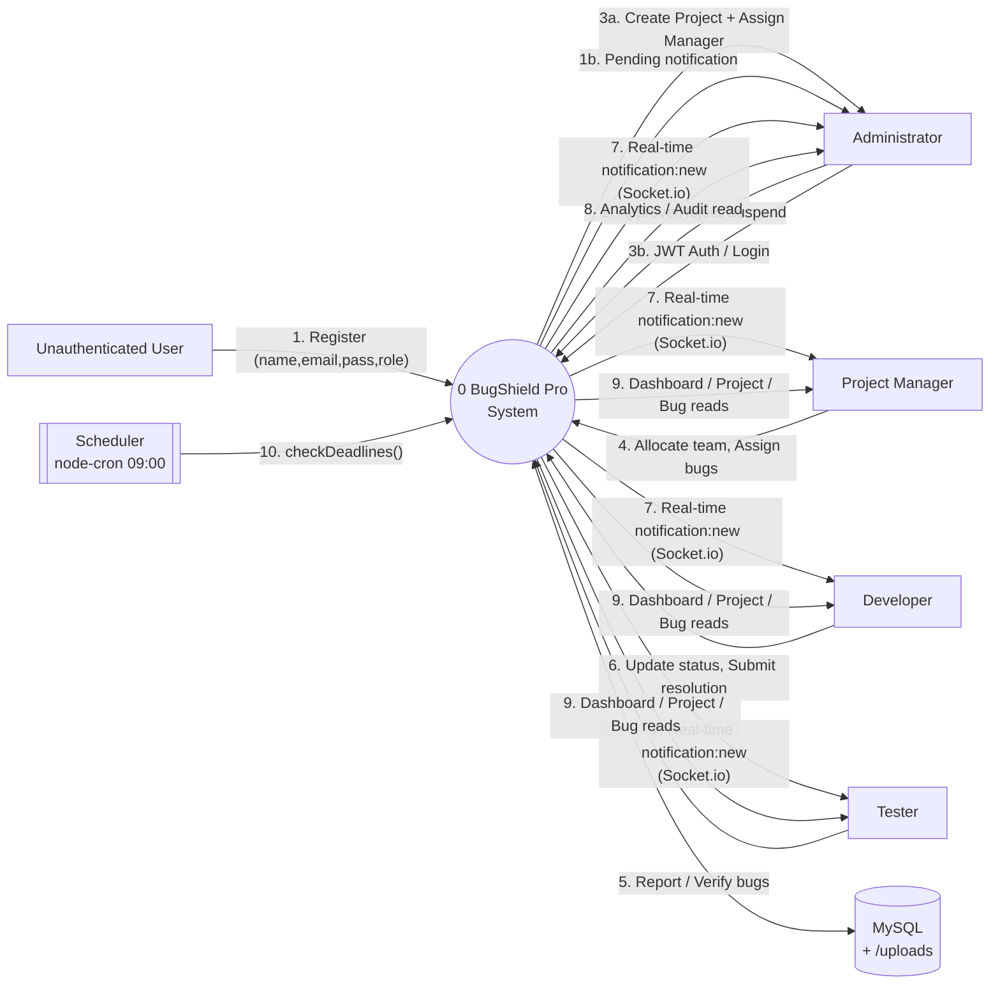
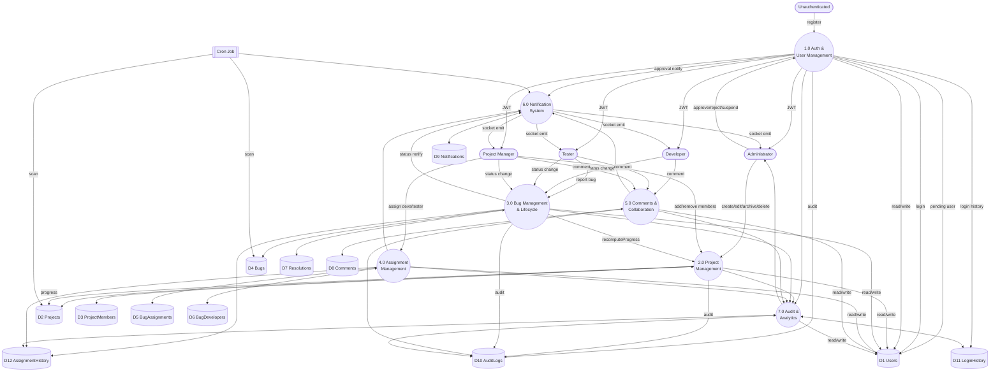
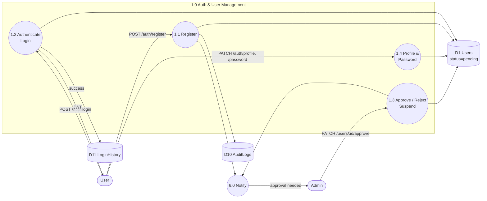
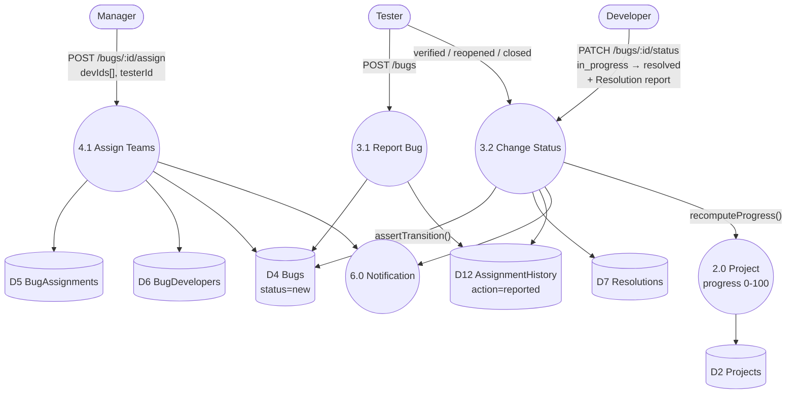
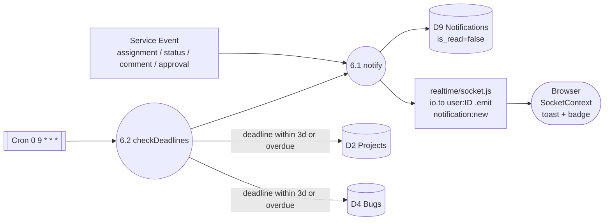

# Data Flow Diagram — BugShield Pro

> Enterprise Bug Tracking & Project Management System
> Stack: React · Express · MySQL (Sequelize) · Socket.io · node-cron
> Data Stores: 12 tables (see `database-schema.md`) · Roles: `admin` / `manager` / `developer` / `tester`

---

## 1. Overview

BugShield Pro centralizes user provisioning, project governance, bug lifecycle, multi-team assignment, real-time notifications and audit analytics into one system.

**External Entities**

| Entity | Role |
|---|---|
| `Unauthenticated User` | Registers as developer/tester |
| `Administrator` | Approves users, creates projects, assigns managers, views audit/analytics |
| `Project Manager` | Manages team, assigns bugs, monitors progress |
| `Developer` | Resolves assigned bugs, submits resolution reports |
| `Tester` | Reports bugs with structured template, verifies fixes |
| `Scheduler (node-cron)` | Daily 09:00 deadline sweep |
| `Browser / Client` | Receives Socket.io pushes & toasts |

**Data Stores (MySQL)**

`D1 Users` · `D2 Projects` · `D3 ProjectMembers` · `D4 Bugs` · `D5 BugAssignments` · `D6 BugDevelopers` · `D7 Resolutions` · `D8 Comments` · `D9 Notifications` · `D10 AuditLogs` · `D11 LoginHistory` · `D12 AssignmentHistory` + `File Store /uploads` for avatars

---

## 2. Level 0 — Context Diagram

System as single process. All roles interact via React SPA → Express REST API (`/api`) and Socket.io (`/socket.io`).



**Key Flows at Level 0**

| # | Flow | Direction | Payload |
|---|---|---|---|
| F1 | Registration | User → System | `name, email, password, role=dev/tester` → D1 (status=pending) + D10 |
| F2 | Approval | Admin → System | `approve/reject` → D1 status=approved, D11, notify |
| F3 | Login | Any → System | `email, password` → verify bcrypt → JWT + D11 + stamp last_login |
| F4 | Project Ops | Admin → System | `name, desc, category, deadline, managerId` → D2 + D3 |
| F5 | Bug Report | Tester → System | `projectId, title, severity, repro steps...` → D4 (status=new) + D12 |
| F6 | Assignment | Manager → System | `developerIds[], testerId` → D5 + D6 + D12 |
| F7 | Status Change | Dev/Tester → System | `status + Resolution{desc,rootCause,codeSummary}` → D4 + D7 + D12 |
| F8 | Comment | Any member → System | `bugId, content` → D8 |
| F9 | Notifications | System → Users | persist D9 + `emitToUser(userId, notification:new)` via Socket.io |
| F10 | Deadline Alerts | Cron → System | scan D2/D4 due within 3d or overdue → D9 |

---

## 3. Level 1 — System Decomposition



### Process Descriptions

| Process | Responsibility | Controllers / Services |
|---|---|---|
| **1.0 Auth & User Mgmt** | Register (pending), JWT login, profile/pwd, admin approve/reject/suspend/create, avatar upload (Multer→/uploads) | `modules/auth`, `modules/users`, `middleware/authenticate, authorize` |
| **2.0 Project Mgmt** | CRUD, archive/restore, soft-delete (paranoid), assign manager, team allocation, progress cache, deadline | `modules/projects/projects.service` + `Project`, `ProjectMember` |
| **3.0 Bug Mgmt** | Report (tester), edit, state-machine `assertTransition()`, mandatory Resolution on `resolved`, verify/reopen/close, history | `modules/bugs/bugLifecycle.js` + `Bug`, `Resolution`, `AssignmentHistory` |
| **4.0 Assignment Mgmt** | PM assigns N developers + 1 tester per bug, reassignment, traceability | `BugAssignment`, `BugDeveloper` |
| **5.0 Comments** | Thread per bug, notify stakeholders | `Comment` |
| **6.0 Notification** | `notify({userId,type,message,link})` → INSERT D9 + `emitToUser(user:ID)`; `notifyMany()` deduped; Cron deadline alerts | `services/notification.service.js` + `realtime/socket.js` |
| **7.0 Audit & Analytics** | Append-only logs, login history, bug stats, velocity, progress, resolution rate | `utils/audit.js` + `modules/analytics` |

---

## 4. Level 2 — Detailed DFDs

### 4.1 User Registration & Approval (Decomposition of 1.0)



### 4.2 Bug Lifecycle (Decomposition of 3.0 + 4.0)



**Enforced State Machine** (`bugLifecycle.js`)

```
new → assigned → in_progress → resolved → verified → closed
                 │                │           │
                 └── reopened ◀──┴───────────┘   reopened → assigned | in_progress
```

Illegal jumps (e.g. `new→resolved`) rejected `400`; `verified/reopened` restricted to dedicated tester/reporter/manager.

### 4.3 Notification & Deadline Cron (Decomposition of 6.0)



---

## 5. Data Flow Dictionary (Level 1)

| Flow | Source → Dest | Data |
|---|---|---|
| `Credentials` | Client → 1.0 | `email, password` |
| `JWT` | 1.0 → Client | `Bearer <token {id,role}>` + Socket handshake |
| `Project Data` | Admin → 2.0 | `name, description, category, startDate, deadline, managerId` |
| `Team Data` | PM → 2.0/4.0 | `projectId, userIds[], roleInProject` |
| `Bug Report` | Tester → 3.0 | `projectId, title, description, steps, expected, actual, env, severity, dueDate` |
| `Resolution Report` | Developer → 3.0 | `description, rootCause, codeChangeSummary` (mandatory for resolved) |
| `Assignment Payload` | PM → 4.0 | `bugId, developerIds[], testerId, assignedBy` |
| `Comment` | Any → 5.0 | `bugId, content` |
| `Notification` | 6.0 → User | `{type, message, link, isRead}` persisted + Socket push |
| `Audit Entry` | All → 7.0 | `{userId, action, entityType, entityId, details, ip_address}` |

---

## 6. Trust Boundaries & Security Flows

- `authenticate` middleware verifies JWT, loads `User`, blocks `status !== approved` (pending/rejected/suspended → 401/403).
- `authorize(...roles)` gates every route (e.g. `POST /projects` admin-only, `POST /bugs` tester-only, `PATCH /bugs/:id/status` dev/tester/manager with assignment check).
- Passwords stored as `password_hash` (BCrypt), never returned in JSON.
- `helmet`, CORS locked to `CLIENT_URL`, Multer file filter for avatars.

---

*Generated for BugShield Pro · Levels 0-2 · Mermaid.js compatible — render in GitHub, VS Code or docsify.*
